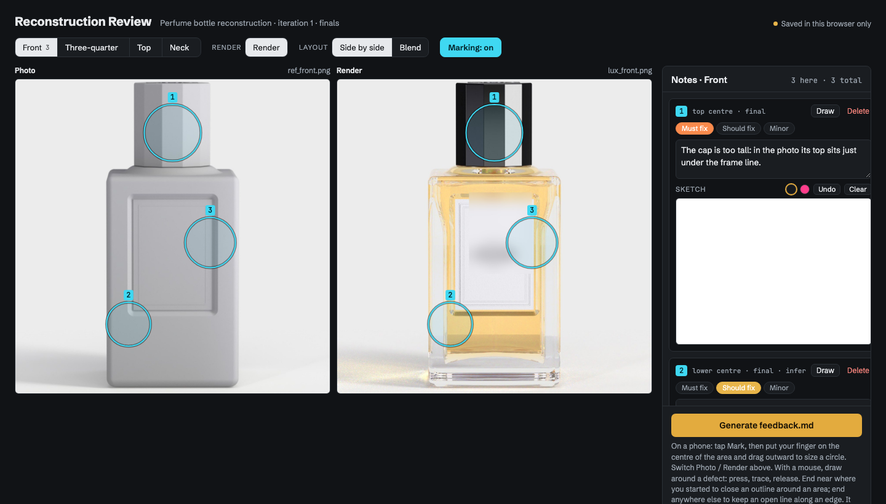

# agentic-cad-reconstruction

**Photos → CAD → photoreal render**, with an AI agent doing the modelling and a human reviewing.

Scripts and method from an exploration: rebuilding real products from a handful of reference photos as exact
geometry, with an AI agent (Claude) writing the model, physical light simulation checking it against the photos,
and a human reviewing each round. The worked example:

- **`perfume/`**: a thick-glass perfume bottle full of liquid, modelled as B-rep CAD (keel), rendered with
  LuxCoreRender (nested dielectrics, measured absorption, dispersion), cameras fitted to each photo, plus the
  cutaway, a Blender layout round trip, and a camera-orbit animation with a video model between ray-traced keys.

The method itself (what worked, what didn't, the review loop) is in **[PLAYBOOK.md](PLAYBOOK.md)**.

## How to use it

Put a few photos of your object in a folder, open **Claude Code** or **Codex** in this repo, and say:

> *"Help me reconstruct the object in `myobject/` from these photos."*

The agent reads `AGENTS.md` and takes it from there: it asks what the object is and for one real dimension (for the
scale), checks your photos and your setup and helps install what's missing, fits a camera to each photo, models,
renders, and sets up the review page. You mark what's wrong; it plans the fixes and applies them. Repeat until the
renders match the photos.

What you bring: the photos, one known size, and your eye. The agent can't judge its own fidelity, so each round
waits for your review (the perfume took about ten). Setup is light for opaque objects (Python and Blender); glass
and liquids also need LuxCoreRender, and a GPU helps.

## What this is, and isn't

- These are working scripts from an exploration, not a library. They are readable and commented, with the
  measured values and the reasoning left in, but they assume the layout described below and you'll adapt paths.
- **No reference photos are included**: they belong to the brands. Put your own in the object's folder, one per
  view, named `ref_<view>.png` (the perfume scripts expect `perfume/ref_front.png`, `ref_three_quarter.png`,
  `ref_top.png`, `ref_neck.png`). The cap emblem in `perfume/emblem.py` is a placeholder for the same reason (the original was
  traced from the photo with `trace_emblem.py`).
- `perfume/parade.py` is written for **[keel](https://github.com/amywork777/keel)**, a small Python CAD language on
  NVIDIA's usd-brep kernel (exact B-rep, USD output). Run it with keel's `bin/keel perfume/parade.py`; it writes the
  meshes (`mesh/*.npz`, exact B-rep normals) that the rendering scripts use.
  keel is a third-party project, not mine: it is not part of this repository, and its repo states no licence at the
  time of writing, so check its terms before reusing its code. This repository's MIT licence covers only the files here.
- Trademarks mentioned in comments belong to their owners; this is a technical exercise with no affiliation.

## Working with the agent, step by step

`AGENTS.md` gives the agent the onboarding and the method (the loop, the rules, where the example scripts are);
`CLAUDE.md` points Claude Code to it, and `PLAYBOOK.md` has the details behind it.

1. Clone the repo and make a folder for your object with your photos in it, named `ref_<view>.png`.
2. Start the agent in the repo (`claude`, or `codex`). The first session covers the object, the scale, the photos
   and the setup.
3. Then ask, for example:
   - *"Reconstruct the object in `mybottle/` from its photos, using `perfume/` as the template. Start by measuring
     the photos and fitting the cameras."*
   - *"Render clay views from every fitted camera and build a comparison sheet."*
   - *"Publish the photo/render pairs on the review page."*
4. Review the renders on the feedback page (`tools/review_page/`), export the notes, and give the export to the agent:
   *"Here is the review for iteration 2: write iteration_2_plan.md."* Approve the plan, let it execute, repeat.

Claude does the measuring, modelling, fitting and rendering; you judge the results and steer each round.

### The feedback editor

Each reference photo sits next to the render from the same fitted camera (side by side, or blended with a slider).
You circle what's wrong (freehand with a mouse, or a circle with a finger on a phone), set a severity, and add a
comment, a sketch, or nothing at all: an empty note asks Claude to find the difference itself by comparing the
marked area closely. *Generate feedback.md* exports the review with one picture per note. (Screenshot with
placeholder images: a clay render stands in for the photo, and the label is blurred.)

## Layout

| Folder | What | Main scripts |
|---|---|---|
| `perfume/` | model, cameras, render, review | `parade.py` (model), `fit_poses.py` + `fit_neck.py` (cameras), `section_overlay.py` (shape gate), `parade_lux.py` (LuxCore), `make_review.py` + `region_check.py` (review sheets), `cut_meshes.py` + `cutaway.py` (cutaway) |
| `perfume/blend/` | edit the scene in Blender, render in LuxCore | `make_blend.py`, `read_layout.py`, `render_layout.sh` |
| `perfume/` (motion) | orbit keys + video model | `orbit_segs.sh`, `orbit_ltx_3k.sh` |
| `AGENTS.md` | instructions for the agent: onboarding, the loop, the rules, where the examples are (`CLAUDE.md` imports it) | |
| `tools/review_page/` | the feedback editor (photo vs render, marks, notes, export) | `index.html` |

## Requirements

- Python 3.10+, `numpy scipy pillow scikit-image matplotlib` (see `requirements.txt`)
- Blender 4.2+ (its `bpy` as a module or the app) for the Cycles previews and the layout round trip
- LuxCoreRender's Python module (`pyluxcore`) for the glass renders; a CUDA GPU helps a lot
- [keel](https://github.com/amywork777/keel) for `perfume/parade.py` only (native build on macOS, or Docker / `pip install usd-brep` on Linux)
- Optional: an LTX video model checkout for the orbit animation (`LTX_DIR`)

Remote rendering settings are environment variables: `RENDER_HOST`, `SSH_KEY`, `REMOTE_DIR`, `LUX_PYTHON`,
`LUX_NVRTC_LIB`, `BLENDER`, `LTX_DIR`.

## Licence

MIT, see `LICENSE`.
